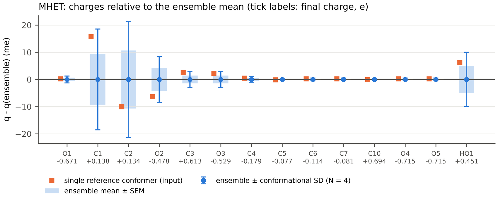

<b>This tutorial computes ABCG2 partial charges for a flexible small molecule as an average over its conformers, adding one conformer at a time until the per-atom mean is statistically converged. Mono(2-hydroxyethyl) terephthalate (MHET), the product of PET hydrolysis by PETase and the substrate of MHETase, is used as the worked example.</b>

ABCG2 charges, like AM1-BCC, depend on the conformation used to compute them. A single conformer can leave a flexible molecule with charges that reflect one particular geometry, for example an internal hydrogen bond or two polar groups folded onto each other. The scripts in this repository build a filtered pool of conformers, charge them with antechamber, follow the running mean of every atom, and write the averaged charges as a mol2 file with GAFF2 types, a frcmod file and an Amber library. A second script turns the output into figures and a report. The <a href="covalent_ligand.html">second page</a> of the tutorial does the same for a ligand covalently bound to a protein residue, using the acyl-enzyme that MHETase forms from MHET as the example, and the <a href="oligomer_fragments.html">third page</a> builds the residues of an oligomer, a PET pentamer, from capped fragments.

It requires <a href="https://ambermd.org/AmberTools.php" target="_blank">AmberTools</a> with ABCG2 support (antechamber, sqm and parmchk2; tleap is optional), Python 3.8 or newer, <a href="https://www.rdkit.org/" target="_blank">RDKit</a>, NumPy and, for the analysis, Matplotlib. The example was run with AmberTools 25 and RDKit 2026.03 from conda-forge:

<pre style="color: white; background-color: black;">
conda create -n abcg2 -c conda-forge ambertools rdkit numpy matplotlib
conda activate abcg2
</pre>

| File | Description |
| :--- | :--- |
| <a href="abcg2_conformer_charges.py">abcg2_conformer_charges.py</a> | Builds the conformer pool, runs antechamber on each conformer and writes the averaged charges |
| <a href="abcg2_covalent_charges.py">abcg2_covalent_charges.py</a> | The same for a ligand covalently bound to a residue, computed on the capped residue with fixed cap charges (<a href="covalent_ligand.html">page 2</a>) |
| <a href="abcg2_fragment_assembly.py">abcg2_fragment_assembly.py</a> | Residue charges of an oligomer from capped fragments, Amber library and comparison with the whole chain (<a href="oligomer_fragments.html">page 3</a>) |
| <a href="abcg2_analysis.py">abcg2_analysis.py</a> | Figures (600 dpi) and a Markdown report from one or more output directories |
| <a href="example/MHET.mol2">example/MHET.mol2</a> | Input structure of MHET (carboxylate form, all hydrogens) |
| <a href="https://github.com/arvpinto/abcg2_charges_multi/tree/main/example/MHET_abcg2" target="_blank">example/MHET_abcg2/</a> | Complete output of the MHET run shown below |
| <a href="https://github.com/arvpinto/abcg2_charges_multi/tree/main/example/MHET_analysis" target="_blank">example/MHET_analysis/</a> | Figures and report from abcg2_analysis.py |

---

<h2> 
 <b>I - How the calculation works</b> 
</h2>

- 
<b>Reading the input.</b> Only a mol2 file is needed. Atom names, atom order and the residue name are kept. Bond orders, formal charges and stereochemistry are perceived from the connectivity and the net charge, which is taken from the mol2 charges, from -nc, or set to 0.

- 
<b>Conformer pool.</b> Conformers are embedded with ETKDGv3 (500 by default) and minimised with MMFF94s with a screened dielectric (eps = 4). Conformers with inverted stereochemistry are removed.

- 
<b>Filters.</b> A conformer is rejected if it has an intramolecular hydrogen bond (H...A &le; 2.5 &Aring;, D-H...A &ge; 120&deg;, donor and acceptor at least 4 bonds apart), a contact between formally charged atoms (&le; 4 &Aring;), N or O atoms at least 5 bonds apart that come closer than 5 &Aring;, a cis secondary amide, or an MMFF energy more than 15 kcal/mol above the lowest conformer. The same contact filters are applied again after the AM1 minimisation in sqm.

- 
<b>Duplicates and order.</b> Near-duplicates (heavy-atom RMSD below 0.5 &Aring;, accounting for symmetry and, for achiral molecules, mirror images) are removed, and the pool is shuffled with a fixed seed so that conformers are used in a random order.

- 
<b>Charges.</b> antechamber -c abcg2 -at gaff2 (with the standard sqm AM1 minimisation) runs on several conformers in parallel, and the results are used in the order of the shuffled pool.

- 
<b>Convergence.</b> After every accepted conformer the running mean, standard deviation (SD) and standard error of the mean (SEM) of each atom are updated. The run stops when at least 20 conformers are accepted, the largest per-atom SEM is &le; 0.001 e and the largest change of the running mean over the last 5 conformers is &le; 0.0005 e, or when 80 conformers are accepted.

- 
<b>Reference conformer.</b> One extended conformer is also charged on its own: the input, if it passes the filters and has no gauche torsion, or otherwise an all-trans structure built from it. Its AM1-relaxed geometry carries the final charges.

- 
<b>Final charges.</b> The ensemble mean is averaged over symmetry-equivalent atoms, corrected to the exact net charge and rounded to 10-6 e. It is written as a mol2 file with GAFF2 types, together with a frcmod file from parmchk2 and, if tleap is available, a checked Amber library.

<h2> 
 <b>II - Preparing the input</b> 
</h2>

The mol2 file must contain one molecule with all hydrogens in the intended protonation state and unique atom names. At neutral pH the carboxylic acid of MHET is deprotonated, so the example uses the carboxylate (net charge -1) with the hydroxyl and the ester intact, in an extended conformation (O-C-C-O and C-C-O-C anti). The residue name in the file, MHT, is kept in the output and can be changed with -rn:

<pre style="color: white; background-color: black;">
@&lt;TRIPOS&gt;ATOM
      1 O1         5.2072     0.5310     0.8953 O.3       1 MHT      0.000000
      2 C1         3.8019     0.7264     1.0098 C.3       1 MHT      0.000000
      3 C2         3.0291    -0.3772     0.2974 C.3       1 MHT      0.000000
      4 O2         1.6295    -0.0978     0.3918 O.3       1 MHT      0.000000
      5 C3         0.8421    -0.9742    -0.2844 C.2       1 MHT      0.000000
...
</pre>

O1 and HO1 are the hydroxyl, C1 and C2 the ethylene carbons, O2, C3 and O3 the ester, C4 to C9 the ring and C10, O4 and O5 the carboxylate. The charges in the file are zero, so the net charge has to be given with -nc.

<h2> 
 <b>III - A first run with the default settings</b> 
</h2>

<pre style="color: white; background-color: black;">
python3 abcg2_conformer_charges.py MHET.mol2 -nc -1 -o MHET_default
</pre>

<pre style="color: white; background-color: black;">
Building the pool: 500 ETKDGv3 conformers, mmff94s (eps = 4.0) ...
Pool: 9 embedded, 1 pass the filters after duplicate removal
WARNING: fewer pool conformers than --min-confs; raise -n or relax the filters.
  reference: done in 45 s; after sqm 1 gauche, Rg 3.29 A, issues: polar contact 4.73 A
  c001: rejected after sqm (polar contact 4.73 A)
ERROR: no conformer was accepted.
</pre>

The defaults are tuned for long, flexible molecules, and two of them do not suit a molecule as small as MHET. Every file written by the script helps to find out why; here the reasons are in MHET_default/MHET_pool.csv:

- 
<b>The N/O distance filter.</b> Eight of the nine conformers are rejected for a "polar contact". The filter checks N and O atoms at least 5 bonds apart (--polar-topo 5), and in MHET exactly one such pair sits at that limit: the hydroxyl O1 and the ester carbonyl O3 (O1-C1-C2-O2-C3=O3). Their distance, 3.1 to 5.0 &Aring; in the pool, follows from the covalent geometry of the hydroxyethyl ester and is not the kind of folding of distant groups that the filter is meant to catch. The other N/O pairs of MHET are 7 to 10 bonds apart, on opposite sides of the ring.

- 
<b>The size of the pool.</b> MHET has only a handful of distinct conformers: with the default duplicate threshold (0.5 &Aring;) four remain after minimisation, however many structures are embedded, so the default minimum of 20 conformers cannot be reached. A finer threshold keeps more of them, but they relax to the same few AM1 minima (see section VI).

<h2> 
 <b>IV - Running the calculation for MHET</b> 
</h2>

Raising --polar-topo to 6 removes the O1/O3 pair from the check and keeps every other filter as it is. Nothing else is changed:

<pre style="color: white; background-color: black;">
python3 abcg2_conformer_charges.py MHET.mol2 -nc -1 --polar-topo 6
</pre>

<pre style="color: white; background-color: black;">
Molecule O=C([O-])c1ccc(C(=O)OCCO)cc1: 24 atoms, net charge -1, residue MHT
Output: MHET_abcg2
Input geometry: Rg 3.41 A, 0 gauche, issues: none
Reference conformer: input (0 gauche, Rg 3.41 A, issues: none)
Building the pool: 500 ETKDGv3 conformers, mmff94s (eps = 4.0) ...
Pool: 9 embedded, 4 pass the filters after duplicate removal
WARNING: fewer pool conformers than --min-confs; raise -n or relax the filters.
Running abcg2 with 2 worker(s); stop when N >= 20, max SEM <= 0.001 e and max drift over 5 <= 0.0005 e
  c001: N=  1      7 s  max SEM nan  max drift nan  (0 gauche, Rg 3.37 A)
  reference: done in 44 s; after sqm 1 gauche, Rg 3.29 A, issues: none
  c002: N=  2     46 s  max SEM 0.0210  max drift nan  (1 gauche, Rg 3.29 A)
  c003: N=  3      6 s  max SEM 0.0143  max drift nan  (1 gauche, Rg 3.26 A)
  c004: N=  4     12 s  max SEM 0.0107  max drift nan  (1 gauche, Rg 3.29 A)
WARNING: not converged; the SEM is reported. Raise -n or --max-confs.

Accepted 4 of 4 runs (0 rejected); converged: False
Final max SEM 0.0107 e; largest conformational SD 0.0214 e (C2)
Largest |ensemble - reference conformer| 0.0157 e (C1)
tleap check: charge -1.000000, errors 0, warnings 1
Charges: MHET_abcg2/MHET_abcg2_ensemble.mol2
frcmod:  MHET_abcg2/MHET.frcmod
Analyse with: python3 abcg2_analysis.py MHET_abcg2
</pre>

The whole run took about one minute on 2 CPU cores. Of the nine embedded conformers, four are duplicates and one has an internal hydrogen bond from the hydroxyl, so the pool holds four conformers, and all four are accepted after the AM1 minimisation. The run stops because the pool is used up, not because the criteria are met, hence the "not converged" warning: this is expected for a molecule with so few conformers (see section VI). The single tleap warning only reports that the net charge of the unit is not zero, which is correct for the MHET anion.

The output directory holds the final charges (MHET_abcg2_ensemble.mol2), the charges of the reference conformer alone (MHET_abcg2_reference_only.mol2), MHET.frcmod, tleap/MHET.lib, the accepted AM1 geometries (MHET_accepted_sqm.pdb) and the tables read by the analysis script: the pool, every antechamber run, the charges of every conformer, the running mean and a per-atom summary.

<h2> 
 <b>V - Analysis</b> 
</h2>

<pre style="color: white; background-color: black;">
python3 abcg2_analysis.py MHET_abcg2 --labels MHET -o MHET_analysis
</pre>

The script saves four figures at 600 dpi (shown on screen unless --no-show is given) and a report, <a href="example/MHET_analysis/abcg2_report.md">abcg2_report.md</a>. Several runs can be compared by giving several directories. The most informative figure is the per-atom comparison, where every symmetry-unique atom is shown relative to its ensemble mean (click it for the full-resolution version):

    

The blue bars are the conformational SD and the shaded boxes the SEM; the orange squares are the charges of the single reference conformer. The charges move only where the molecule is flexible: C1, C2 and the hydroxyl hydrogen HO1 have conformational SDs of 0.01 to 0.02 e and O2 of about 0.009 e, while those of the ring carbons and the carboxylate are 0.001 e or less. The other three figures follow the convergence (worst-atom SEM and drift against N), the running mean of the most variable atoms, and the correlation of the charges with the shape of each conformer. With only four conformers they carry little information: the drift needs at least six conformers and the correlation coefficients rest on four points.

<h2> 
 <b>VI - Results for MHET</b> 
</h2>

Final ABCG2 charges for each symmetry-unique atom (the number in brackets counts the equivalent atoms), with their conformational SD and the charge of the single reference conformer:

| Atom | GAFF2 type | Final q (e) | SD (e) | Reference (e) |
| :--- | :--- | ---: | ---: | ---: |
| O1 | oh | -0.6712 | 0.0013 | -0.6710 |
| HO1 | ho | +0.4508 | 0.0100 | +0.4570 |
| C1 | c3 | +0.1379 | 0.0186 | +0.1536 |
| H11 (2) | h1 | +0.0472 | 0.0049 | +0.0472 |
| C2 | c3 | +0.1336 | 0.0214 | +0.1236 |
| H21 (2) | h1 | +0.0609 | 0.0059 | +0.0557 |
| O2 | os | -0.4778 | 0.0085 | -0.4841 |
| C3 | c | +0.6132 | 0.0029 | +0.6157 |
| O3 | o | -0.5292 | 0.0029 | -0.5270 |
| C4 | ca | -0.1791 | 0.0010 | -0.1786 |
| C5 (2) | ca | -0.0773 | 0.0003 | -0.0775 |
| H5 (2) | ha | +0.1105 | 0.0012 | +0.1095 |
| C6 (2) | ca | -0.1137 | 0.0005 | -0.1135 |
| H6 (2) | ha | +0.1417 | 0.0003 | +0.1415 |
| C7 | ca | -0.0808 | 0.0005 | -0.0806 |
| C10 | c | +0.6936 | 0.0000 | +0.6936 |
| O4, O5 | o | -0.7147 | 0.0005 | -0.7145 |

The ensemble and the single reference conformer differ by 0.0045 e (RMS) and at most 0.0157 e (C1). The largest conformational SD belongs to C2, the CH2 bonded to the ester oxygen, and it is set by a single torsion: C2 carries +0.1656 e in the conformer with an anti O-C-C-O torsion and +0.1216 to +0.1236 e in the three gauche ones.

Two details matter for how these numbers should be read:

- 
<b>Conformers can merge during the AM1 minimisation.</b> Duplicates are removed from the MMFF pool, but two different MMFF conformers can relax to the same AM1 minimum. In this run c002 starts with an anti O-C-C-O torsion, turns gauche during the sqm minimisation and ends identical to c004: same charges, same AM1 heat of formation (-229.8208 kcal/mol). The extended reference conformer relaxes into the same minimum. The four accepted conformers therefore represent three distinct AM1 minima, one of them counted twice. Repeated values in the am1_hof_kcal column of MHET_conformer_runs.csv are a quick way to spot this.

- 
<b>The mean is unweighted.</b> Each accepted conformer counts once, with no Boltzmann weighting. For a flexible molecule with many conformers this is a random sample; for MHET it is a set of three or four structures, and the result depends on how many of them are gauche or anti. With the current pool three of the four are gauche, which is why the final charge of C2 (+0.1336 e) lies close to the gauche values.

For small molecules like MHET the convergence criteria cannot be met, and the reported SEM describes the spread between a few conformers rather than a sampling error. The per-atom SD is the more useful number: here it shows that only the hydroxyethyl ester is sensitive to conformation, by up to about 0.02 e. For larger, more flexible molecules the defaults apply as they are and the run stops on the convergence criteria.

<h2> 
 <b>VII - Using the charges</b> 
</h2>

MHET_abcg2_ensemble.mol2 has GAFF2 atom types and the final charges, and MHET.frcmod holds the parameters missing from GAFF2. In tleap they are loaded in the same way as the check that the script runs on its own (tleap/leap.in):

<pre style="color: white; background-color: black;">
source leaprc.gaff2
loadamberparams MHET.frcmod
MHT = loadmol2 MHET_abcg2_ensemble.mol2
check MHT
saveoff MHT MHET.lib
</pre>

tleap/MHET.lib, already written by the script, can be loaded instead with loadoff MHET.lib after the frcmod file.

When the ligand is covalently bound to the protein, as in the acyl-enzyme that MHETase forms from MHET, the charges have to be derived for the modified residue as a whole; this is covered on the <a href="covalent_ligand.html">next page</a>.

---

### Useful Links:

- <a href="https://ambermd.org/AmberTools.php" target="_blank">AmberTools</a>
- <a href="https://www.rdkit.org/docs/" target="_blank">RDKit documentation</a>
- <a href="https://arvpinto.github.io/GAFF2_dihedral_parameterization/" target="_blank">Parameterization of a dihedral angle with QM (GAFF2)</a>
