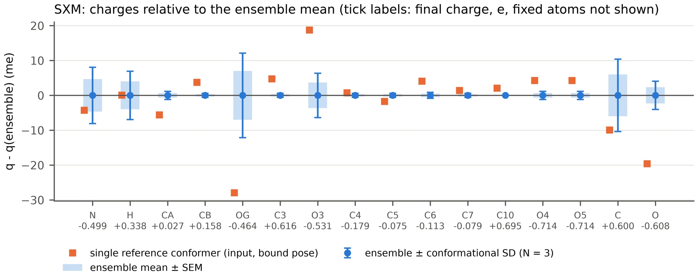
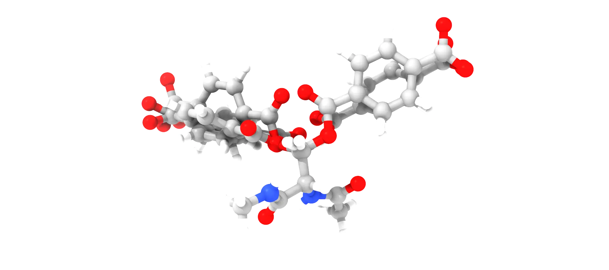

<b>This page computes conformer-averaged ABCG2 charges for a ligand covalently bound to a protein residue. The example is the acyl-enzyme of MHETase: after the catalytic serine attacks the ester of MHET and ethylene glycol leaves, the terephthaloyl group stays bound to the serine O&gamma; as an ester until it is hydrolysed.</b>

The ligand and the residue it is bound to form a single residue in the force field, so the charges are derived for the modified residue as a whole. As is usual for non-standard amino acids, they are computed on the capped residue, here ACE-Ser(acyl)-NME, where the acetyl and N-methylamide groups stand in for the neighbouring residues and complete the two peptide bonds. The charges of the caps are then fixed to the values they have in the Amber protein force fields, which sum to zero, so that the modified residue carries exactly its integer charge and meets its neighbours like any other residue; the charges of all the other atoms are computed. The script <a href="abcg2_covalent_charges.py">abcg2_covalent_charges.py</a> does this with the machinery of the <a href="./">first page</a>, which it imports, so both scripts must be in the same directory. The conda environment of the first page is enough: SciPy, used for the restrained AM1 minimisation described below, is installed with AmberTools from conda-forge.

| File | Description |
| :--- | :--- |
| <a href="abcg2_covalent_charges.py">abcg2_covalent_charges.py</a> | Conformer-averaged charges of the capped residue with fixed cap charges, residue mol2, frcmod files and Amber library |
| <a href="abcg2_analysis.py">abcg2_analysis.py</a> | Figures (600 dpi) and a Markdown report, as on the first page |
| <a href="example/covalent/SXM_origin.pdb">example/covalent/SXM_origin.pdb</a> | Capped acyl-serine as provided (generic atom names) |
| <a href="example/covalent/SXM.mol2">example/covalent/SXM.mol2</a> | The same structure with the atom names used here, the input of the script |
| <a href="https://github.com/arvpinto/abcg2_charges_multi/tree/main/example/covalent/SXM_abcg2" target="_blank">example/covalent/SXM_abcg2/</a> | Complete output of the run shown below |
| <a href="https://github.com/arvpinto/abcg2_charges_multi/tree/main/example/covalent/SXM_analysis" target="_blank">example/covalent/SXM_analysis/</a> | Figures and report from abcg2_analysis.py |
| <a href="https://github.com/arvpinto/abcg2_charges_multi/tree/main/example/covalent/variants" target="_blank">example/covalent/variants/</a> | Logs, charges and residue mol2 files of the variants of section VII |

---

<h2> 
 <b>I - How the calculation differs for a covalent ligand</b> 
</h2>

- 
<b>The capped model.</b> The input is a mol2 file of the capped residue with the ligand attached, all hydrogens present and unique atom names. The caps are found with a SMARTS pattern for CH3-C(=O)-N-C-C(=O)-N(H)-CH3, or taken from --ace and --nme, and with them the backbone of the residue (N, H, CA, HA, C and O).

- 
<b>The backbone stays at the protein geometry.</b> In the protein, &phi; and &psi; of the residue are set by the fold, not by the residue itself. While the pool is built, the caps and N, H, CA, HA, C and O are held at their input coordinates (ETKDGv3 with a coordinate map, then MMFF94s with these atoms fixed), so that only the side chain and the ligand are sampled. With --backbone free the whole capped residue is sampled instead.

- 
<b>Restrained AM1 minimisation.</b> antechamber minimises the whole molecule with sqm, which cannot restrain atoms, and in vacuum the capped residue then folds onto itself (section III). With the backbone fixed, the script minimises the free atoms itself with L-BFGS-B, taking AM1 energies and gradients from sqm single points, and antechamber then computes the ABCG2 charges at that restrained minimum (sqm with maxcyc=0). The charges are still computed on an AM1 minimum, as ABCG2 expects, only with the backbone held where the protein holds it.

- 
<b>Filters.</b> The filters of the first page are used, with two changes. Contacts between two frozen atoms that are already present in the input belong to the protein geometry and are not counted. The N/O distance filter is applied only to pairs of free atoms, since pairs with a backbone or cap atom, such as OY and OG (5 bonds apart), are close because of the covalent structure of the residue (--polar-frozen checks them too). Intramolecular hydrogen bonds are checked for all atoms, including the N-H groups of the backbone and the caps. After the AM1 step a conformer is also rejected if &phi; or &psi; moved by more than 60&deg; (--bb-tol), which only happens with --am1-opt full.

- 
<b>Final charges.</b> The ensemble mean is averaged over symmetry-equivalent atoms. The caps are then set to the ACE (aminont12.lib) and NME (aminoct12.lib) charges, which ff14SB and ff19SB share, and the difference between the ABCG2 charge of the caps and these values is spread evenly over the free atoms (--redistribute even, the default) or put back on the atoms bonded to the caps, N and C (--redistribute junction). --fix-backbone also fixes N, H, C and O to the standard backbone charges, and --fixed-charges fixes any atom to a given value.

- 
<b>Residue and library.</b> The residue without the caps is written as a mol2 file with the protein atom types on the backbone (N, H, CX, H1, C, O for ff14SB; XC instead of CX for ff19SB) and GAFF2 types from CB onwards, and turned into an Amber library with N as head and C as tail. tleap checks it inside an ACE-residue-NME peptide built with the protein force field, and the bonded terms that it cannot find between the protein and the GAFF2 atom types are written to a junction frcmod file (section VIII).

<h2> 
 <b>II - Preparing the input</b> 
</h2>

SXM_origin.pdb holds the capped acyl-serine with generic atom names (C1, C2, ...). Before anything else the atoms need names that will work in the protein. The backbone of the residue keeps the standard names N, H, CA, HA, C and O, because tleap joins the residue to its neighbours through N and C and the protein PDB file uses these names; the side chain follows serine (CB, HB2, HB3, OG); the terephthaloyl atoms keep the names they have in MHET on the first page, so that the two sets of charges can be compared; and the caps, which are part of the same molecule, get names that do not clash with the residue, here those of the CHARMM ACE and CT3 patches. The residue name, SXM, is arbitrary and can be changed with -rn.

| Part | SXM_origin.pdb | SXM.mol2 |
| :--- | :--- | :--- |
| ACE cap | C6, H5, H6, H7, C4, O3 | CAY, HY1, HY2, HY3, CY, OY |
| Backbone | N1, H4, C1, H1, C3, O2 | N, H, CA, HA, C, O |
| Side chain | C2, H2, H3, O1 | CB, HB2, HB3, OG |
| Acyl group | C5, O4 | C3, O3 |
| Ring | C7, C8, H8, C10, H10, C12, C11, H11, C9, H9 | C4, C5, H5, C6, H6, C7, C8, H8, C9, H9 |
| Carboxylate | C13, O5, O6 | C10, O4, O5 |
| NME cap | N2, H12, C14, H13, H14, H15 | NT, HNT, CAT, HT1, HT2, HT3 |

The renamed structure (<a href="example/covalent/SXM.pdb">SXM.pdb</a>) was converted with antechamber, which assigns the bonds from the geometry. SYBYL types are enough, since the script perceives bond orders and formal charges itself:

<pre style="color: white; background-color: black;">
antechamber -i SXM.pdb -fi pdb -o SXM.mol2 -fo mol2 -at sybyl -pf y
</pre>

<pre style="color: white; background-color: black;">
@&lt;TRIPOS&gt;ATOM
      1 CAY          6.3420    -1.0490    -0.6910 C.3        1 SXM       0.000000
      2 HY1          6.6920    -2.0370    -0.9540 H          1 SXM       0.000000
      ...
      7 N            4.2040    -0.1100    -0.0560 N.am       1 SXM       0.000000
      8 H            4.7310     0.5620     0.4570 H          1 SXM       0.000000
      9 CA           2.8050     0.2070    -0.2130 C.3        1 SXM       0.000000
...
</pre>

The carboxylate makes the net charge -1, which has to be given with -nc because the charges in the file are zero. In this structure the backbone is in the &beta; region (&phi; -153&deg;, &psi; 177&deg;), and the N-H of the NME cap points at O&gamma; (2.15 &Aring;).

<h2> 
 <b>III - A first run with the standard AM1 minimisation</b> 
</h2>

With --am1-opt full, every conformer goes through the usual antechamber minimisation of all atoms, as on the first page:

<pre style="color: white; background-color: black;">
python3 abcg2_covalent_charges.py SXM.mol2 -nc -1 --am1-opt full --no-tleap -o SXM_full_am1
</pre>

<pre style="color: white; background-color: black;">
...
AM1 geometry: full
  reference: done in 32 s; after AM1 phi -112.0, psi 164.3, Rg 4.11 A, issues: 1 H-bond
  c001: rejected after AM1 (1 H-bond; backbone moved (dphi 29, dpsi 124 deg))
  c002: rejected after AM1 (2 H-bond; backbone moved (dphi 64, dpsi 113 deg))
  c003: rejected after AM1 (1 H-bond; backbone moved (dphi 62, dpsi 109 deg))
  c004: rejected after AM1 (1 H-bond; backbone moved (dphi 30, dpsi 126 deg))
  c005: rejected after AM1 (1 H-bond)
ERROR: no conformer was accepted.
</pre>

In vacuum nothing holds the backbone, and the capped residue folds to make intramolecular hydrogen bonds. c002 and c003 end in the C7eq turn (&phi; about -90&deg;, &psi; about 65&deg;) with the N-H of NME bonded to the carbonyl O of ACE, c001 and c004 turn &psi; by about 125&deg; and bond the same N-H to O&gamma;, and c005 bonds it to the ester carbonyl O3. In the protein these groups are hydrogen bonded to the rest of the enzyme and to water, and the backbone keeps the conformation of the fold, so none of these structures represents the residue. The full log is in <a href="example/covalent/SXM_full_am1.log">SXM_full_am1.log</a>. This is why the backbone is kept fixed by default, also in the AM1 minimisation.

<h2> 
 <b>IV - Running the calculation</b> 
</h2>

<pre style="color: white; background-color: black;">
python3 abcg2_covalent_charges.py SXM.mol2 -nc -1
</pre>

<pre style="color: white; background-color: black;">
Molecule CNC(=O)[C@H](COC(=O)c1ccc(C(=O)[O-])cc1)NC(C)=O: 37 atoms, net charge -1, residue SXM
Output: SXM_abcg2
Caps: ACE CAY HY1 HY2 HY3 CY OY; NME NT HNT CAT HT1 HT2 HT3
Backbone: N N, H H, CA CA, HA HA, C C, O O
Input backbone: phi -153.1, psi 176.5, omega(ACE) 170.6, omega(NME) 177.1 deg
Fixed charges: 12 atoms (caps); 25 free atoms; redistribution even
Pool: caps and backbone fixed (18 frozen atoms)
Contacts inside the frozen part (not counted): 0 H-bond, 1 N/O, 0 ionic
Input geometry: Rg 4.06 A, issues: H-bond NT-HNT...OG 2.15 A
  NOTE: the input (bound pose) is still used as the reference conformer.
Building the pool: 500 ETKDGv3 conformers, mmff94s (eps = 4.0) ...
Pool: 15 embedded, 5 pass the filters after duplicate removal
WARNING: fewer pool conformers than --min-confs; raise -n or relax the filters.
Running abcg2 with 2 worker(s); stop when N >= 20, max SEM <= 0.001 e and max drift over 5 <= 0.0005 e
AM1 geometry: restrained (18 atoms fixed, L-BFGS to RMS gradient <= 0.02 and max <= 0.1 kcal/mol/A)
  reference: done in 49 s, 177 AM1 steps; after AM1 phi -153.1, psi 176.5, Rg 4.08 A, issues: 1 H-bond
  c001: N=  1    100 s  max SEM nan  max drift nan  ( 367 AM1 steps, Rg 3.95 A)
  c002: rejected after AM1 (1 H-bond)
  c003: N=  2     40 s  max SEM 0.0115  max drift nan  ( 150 AM1 steps, Rg 4.08 A)
  c004: N=  3    171 s  max SEM 0.0077  max drift nan  ( 614 AM1 steps, Rg 3.95 A)
  c005: rejected after AM1 (1 H-bond)
WARNING: not converged; the SEM is reported. Raise -n or --max-confs.

Accepted 3 of 5 runs (2 rejected); converged: False
Final max SEM 0.0077 e; largest conformational SD 0.0133 e (HA)
ABCG2 charge of the caps: ACE +0.0053 e, NME +0.0413 e (fixed to +0.0000 and +0.0000 e); shift per free atom +0.00185 e
Largest |ensemble - reference conformer| 0.0279 e (OG)
Residue SXM: 25 atoms, charge -1.000000 e
tleap, ACE-SXM-NME: 12 missing parameters before the junction frcmod; final check: residue charge -1.000000, errors 0, warnings 3, missing parameters 0
Charges: SXM_abcg2/SXM_abcg2_ensemble.mol2
Residue: SXM_abcg2/SXM_abcg2_residue.mol2
frcmod:  SXM_abcg2/SXM.frcmod
Junction: SXM_abcg2/SXM_junction.frcmod
Library: SXM_abcg2/tleap/SXM.lib
Analyse with: python3 abcg2_analysis.py SXM_abcg2
</pre>

The run took about 7 minutes on 2 CPU cores, most of it in the restrained AM1 minimisations (150 to 900 steps of a fraction of a second each). With the backbone fixed, only the side chain and the ligand change, and they have few distinct conformers: of the 15 structures embedded, nine are rejected because the N-H of NME is hydrogen bonded to O&gamma;, which happens for every structure with &chi;1 near 180&deg;, the rotamer of the input, and one is a duplicate. In the AM1 minimisation c002 rotates into the same rotamer (&chi;1 from -82&deg; to -166&deg;) and makes the same contact, and c005 bonds the N-H of NME to the ester carbonyl O3. Three conformers are accepted, and two of them, c001 and c004, relax to the same AM1 minimum (heats of formation of -235.474 and -235.471 kcal/mol, &chi;1 84&deg; in both). The ensemble therefore represents two minima, both with the C&beta;-O&gamma; bond anti (&chi;2 about 175&deg;) and with &chi;1 at +84&deg; and -88&deg;, and as for MHET on the first page the run stops because the pool is used up. The input itself, the bound pose with the N-H...O&gamma; contact, is kept as the reference conformer.

Together with the files of the first page, the output directory holds the capped model with the final charges (SXM_abcg2_ensemble.mol2), the residue without caps (SXM_abcg2_residue.mol2), the GAFF2 frcmod (SXM.frcmod), the junction frcmod (SXM_junction.frcmod) and, in tleap/, the library SXM.lib, the input and log of tleap and the topology of the ACE-SXM-NME test peptide. The three tleap warnings only report that the net charge of the units is not zero, as expected for this residue.

<h2> 
 <b>V - Analysis</b> 
</h2>

<pre style="color: white; background-color: black;">
python3 abcg2_analysis.py SXM_abcg2 --labels SXM -o SXM_analysis
</pre>

The analysis script reads the output of both scripts. For a covalent run it leaves the fixed atoms out of the per-atom figure (--fixed show puts them back) and adds the charges of the caps, the redistribution and the charge of the residue to the report, <a href="example/covalent/SXM_analysis/abcg2_report.md">abcg2_report.md</a>:

    

The charges that change with the conformation are those around C&alpha; and C&beta;, which follow &chi;1: HA (SD 0.013 e), OG (0.012 e), C (0.010 e), N (0.008 e), H (0.007 e) and O3 (0.006 e). The terephthaloyl group hardly changes (0.004 e for H5 and H9, 0.001 e or less for the other atoms). The reference conformer differs most at OG, which is 0.028 e more negative in the bound pose, where it accepts the hydrogen bond from the N-H of NME, and at O3 (+0.019 e) and O (-0.020 e).

    

The accepted conformers overlaid on the fixed backbone (made with <a href="example/render_conformers.py">example/render_conformers.py</a>), with atoms coloured from red (negative) to blue (positive) by their final charge and the caps in grey.

<h2> 
 <b>VI - Results</b> 
</h2>

Final charges of the residue for each symmetry-unique atom, with the atom type used in the residue library, the conformational SD, the charge of the single reference conformer and, for the terephthaloyl part, the charge of the same atom in free MHET from the first page:

| Atom | Type | Final q (e) | SD (e) | Reference (e) | MHET (e) |
| :--- | :--- | ---: | ---: | ---: | ---: |
| N | N | -0.4987 | 0.0081 | -0.5030 | |
| H | H | +0.3384 | 0.0069 | +0.3384 | |
| CA | CX | +0.0272 | 0.0012 | +0.0216 | |
| HA | H1 | +0.0842 | 0.0133 | +0.0956 | |
| CB | c3 | +0.1578 | 0.0006 | +0.1615 | +0.1336 (C2) |
| HB2, HB3 | h1 | +0.0604 | 0.0051 | +0.0696 | +0.0609 (H21) |
| OG | os | -0.4642 | 0.0121 | -0.4922 | -0.4778 (O2) |
| C3 | c | +0.6159 | 0.0006 | +0.6206 | +0.6132 |
| O3 | o | -0.5308 | 0.0064 | -0.5121 | -0.5292 |
| C4 | ca | -0.1794 | 0.0006 | -0.1787 | -0.1791 |
| C5, C9 | ca | -0.0748 | 0.0006 | -0.0766 | -0.0773 |
| H5, H9 | ha | +0.1182 | 0.0040 | +0.1119 | +0.1105 |
| C6, C8 | ca | -0.1131 | 0.0009 | -0.1091 | -0.1137 |
| H6, H8 | ha | +0.1437 | 0.0008 | +0.1464 | +0.1417 |
| C7 | ca | -0.0791 | 0.0006 | -0.0777 | -0.0808 |
| C10 | c | +0.6955 | 0.0000 | +0.6975 | +0.6936 |
| O4, O5 | o | -0.7138 | 0.0012 | -0.7096 | -0.7147 |
| C | C | +0.6000 | 0.0104 | +0.5900 | |
| O | O | -0.6076 | 0.0040 | -0.6272 | |

Three points stand out:

- 
<b>The caps.</b> In total the caps carry little charge in ABCG2 (+0.0053 e for ACE and +0.0413 e for NME), but atom by atom they differ from the Amber values: the methyl carbon of NME has +0.095 e instead of -0.149 e, its hydrogens +0.042 e instead of +0.098 e, and N -0.499 e instead of -0.416 e. Setting the caps to the Amber values and spreading the remaining 0.047 e over the 25 free atoms shifts each of them by +0.0019 e.

- 
<b>The ligand keeps the charges of free MHET.</b> Apart from the ester, the terephthaloyl group has the charges of MHET within 0.008 e (H5), and within 0.003 e for most atoms. Acylation of the serine changes the charges only around the ester, where OG takes the place of the ester oxygen of MHET (-0.464 e instead of -0.478 e) and CB that of the CH2 (+0.158 e instead of +0.134 e).

- 
<b>The backbone is more polar than in the protein force field.</b> In ff14SB and ff19SB, N, H, C and O carry -0.4157, +0.2719, +0.5973 and -0.5679 e in almost every residue. Here N-H is more polar (-0.499 and +0.338 e) and so is the carbonyl oxygen (-0.608 e), which would make the backbone hydrogen bonds of this residue stronger than those of its neighbours. The next section shows how to keep the standard backbone instead.

<h2> 
 <b>VII - Fixed atoms and redistribution</b> 
</h2>

Which atoms are fixed and where the difference goes only changes the last step, so the ABCG2 runs can be reused: with --reuse, conformers with the same starting coordinates and AM1 setting take their results from an earlier output directory, and each variant runs in seconds:

<pre style="color: white; background-color: black;">
python3 abcg2_covalent_charges.py SXM.mol2 -nc -1 --reuse SXM_abcg2 --redistribute junction -o SXM_junction
python3 abcg2_covalent_charges.py SXM.mol2 -nc -1 --reuse SXM_abcg2 --fix-backbone -o SXM_fixbb
</pre>

| Atom | Default (even) | --redistribute junction | --fix-backbone | ff14SB SER |
| :--- | ---: | ---: | ---: | ---: |
| N | -0.4987 | -0.4952 | -0.4157 | -0.4157 |
| H | +0.3384 | +0.3365 | +0.2719 | +0.2719 |
| CA | +0.0272 | +0.0254 | +0.0247 | -0.0249 |
| HA | +0.0842 | +0.0824 | +0.0817 | +0.0843 |
| CB | +0.1578 | +0.1559 | +0.1552 | +0.2117 |
| OG | -0.4642 | -0.4661 | -0.4668 | -0.6546 |
| C3 | +0.6159 | +0.6140 | +0.6133 | |
| C | +0.6000 | +0.6394 | +0.5973 | +0.5973 |
| O | -0.6076 | -0.6094 | -0.5679 | -0.5679 |

- 
<b>--redistribute junction</b> returns the ABCG2 charge of each cap to the atom bonded to it: the +0.0053 e of ACE goes to N and the +0.0413 e of NME to C, which becomes +0.639 e. The other atoms keep their ensemble mean. This keeps the correction local, at the price of changing one atom by 0.04 e; spreading it evenly changes every atom by 0.002 e.

- 
<b>--fix-backbone</b> also sets N, H, C and O to the standard values, so that the backbone of the modified residue is identical to that of every other residue of the protein, a frequent choice for modified amino acids in Amber force fields. These four atoms carry -0.1754 e in ABCG2 and -0.1144 e when fixed, and the difference is spread over the remaining 21 atoms (-0.0007 e each). The side chain and the ligand are practically unchanged.

The charges of OG and CB show why the side chain needs its own charges: in serine OG is a hydroxyl oxygen with -0.6546 e, while here it is an ester oxygen with -0.464 e.

<h2> 
 <b>VIII - Using the charges in the protein</b> 
</h2>

The script builds the library itself (tleap/leap.in); the part that defines the residue is:

<pre style="color: white; background-color: black;">
source leaprc.protein.ff14SB
source leaprc.gaff2
loadamberparams ../SXM.frcmod
loadamberparams ../SXM_junction.frcmod
SXM = loadmol2 ../SXM_abcg2_residue.mol2
set SXM head SXM.1.N
set SXM tail SXM.1.C
set SXM.1 connect0 SXM.1.N
set SXM.1 connect1 SXM.1.C
set SXM.1 restype protein
saveoff SXM SXM.lib
</pre>

SXM.frcmod has the GAFF2 terms missing from gaff2.dat, as on the first page. Because the backbone has protein atom types and the rest GAFF2 types, the residue also needs the bonded terms that join the two at the CA-CB bond, which neither parameter set has. When ACE-SXM-NME is first built, tleap reports 12 of them: the CX-c3 bond, five angles and six torsions around it. They are taken from parmchk2, which treats CX as c3 (PARMCHK.DAT; for the ff19SB type XC the script adds the same correspondence), and only these terms are written to SXM_junction.frcmod:

<pre style="color: white; background-color: black;">
BOND
CX-c3  228.89   1.535       same as c3-c3, penalty score=  0.0

ANGLE
C -CX-c3   60.360     111.430   same as c -c3-c3, penalty score=  0.0
CX-c3-h1   43.280     109.590   same as c3-c3-h1, penalty score=  0.0
CX-c3-os   77.440     107.620   same as c3-c3-os, penalty score=  0.0
H1-CX-c3   43.280     109.590   same as c3-c3-h1, penalty score=  0.0
N -CX-c3   64.950     112.780   same as c3-c3-n , penalty score=  0.0

DIHE
C -CX-c3-h1   9    1.400         0.000           3.000      same as X -c3-c3-X , penalty score=  0.0
...
</pre>

Run on its own, parmchk2 would also write terms for the protein types themselves (for example the C-O bond, the &psi; torsion O-C-CX-N and the Lennard-Jones parameters of N, C and O), and loading that file would replace ff14SB parameters for the whole protein. Keeping only the terms that tleap reports as missing leaves the protein force field untouched. With both files loaded, the test peptide builds with no missing parameters, and a vacuum minimisation of it with sander moves the heavy atoms by 0.12 &Aring; (RMSD).

To build the enzyme, the catalytic serine in the PDB file is renamed SXM and given the atoms of the residue, with the names of the library (the hydrogens can be left out and are added by tleap). The neighbours are then joined through N and C like any other residue:

<pre style="color: white; background-color: black;">
source leaprc.protein.ff14SB
source leaprc.gaff2
source leaprc.water.opc
loadamberparams SXM.frcmod
loadamberparams SXM_junction.frcmod
loadoff SXM.lib
enz = loadpdb enzyme_acyl.pdb
check enz
</pre>

- 
<b>ff19SB.</b> With --protein-ff ff19SB, CA gets the type XC and the library and junction terms are built with ff19SB. ff19SB assigns its backbone CMAP by residue name, so SXM gets none unless it is added to the list of serine: in a copy of frcmod.ff19SB, change "%FLAG CMAP_RESLIST  1" followed by "SER" into "%FLAG CMAP_RESLIST  2" followed by "SER SXM", and load it after leaprc.protein.ff19SB.

- 
<b>GAFF2 backbone.</b> With --backbone-types gaff2 the whole residue keeps GAFF2 types, and the junction terms move to the two peptide bonds (21 terms in this example). The charges are the same either way.

- 
<b>Other residues and ligands.</b> Nothing in the script is specific to serine or MHET: the caps and the backbone are found from the structure (proline and glycine included), the net charge is given with -nc, and the atoms that are held during the sampling can be extended with --keep-atoms, for example to keep part of the ligand in its bound pose.

---

### Useful Links:

- <a href="./">Conformer-averaged ABCG2 charges for a free molecule (first page)</a>
- <a href="oligomer_fragments.html">Residue charges of an oligomer from capped fragments (third page)</a>
- <a href="https://ambermd.org/AmberTools.php" target="_blank">AmberTools</a>
- <a href="https://www.rdkit.org/docs/" target="_blank">RDKit documentation</a>
- <a href="https://arvpinto.github.io/GAFF2_dihedral_parameterization/" target="_blank">Parameterization of a dihedral angle with QM (GAFF2)</a>
