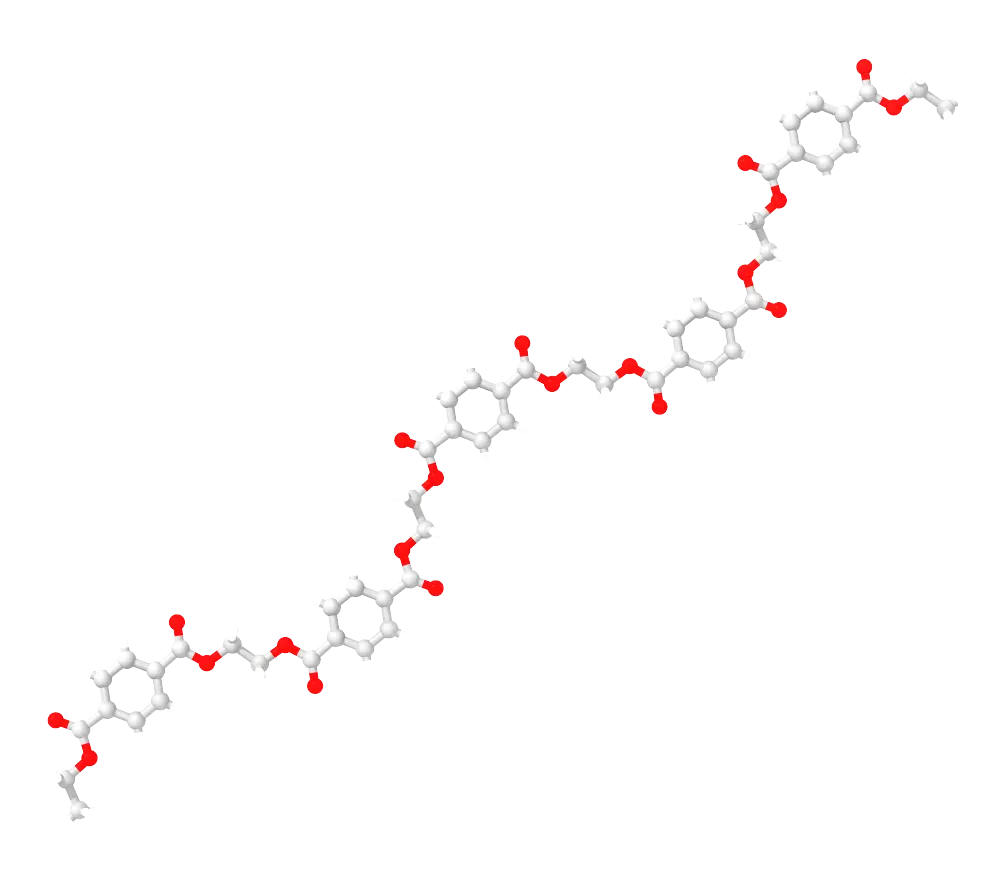
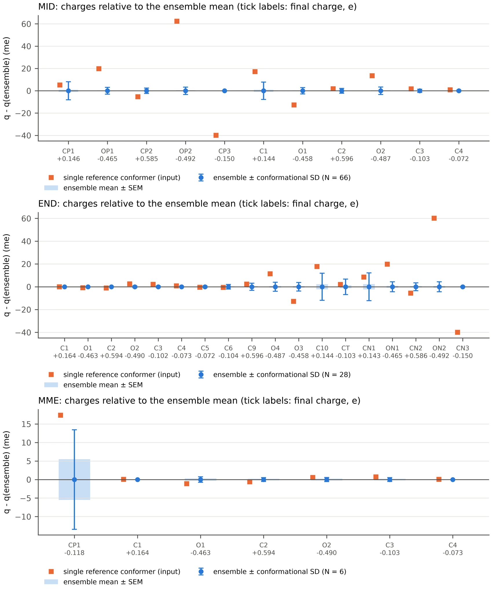
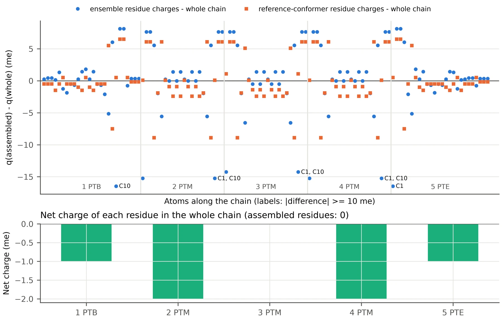

    

<b>This page derives conformer-averaged ABCG2 charges for an oligomer from small capped fragments, and assembles them into residues that build the chain. The example is a PET pentamer: five ethylene terephthalate repeat units with ethyl ester ends.</b>

The charges of a whole oligomer could be computed in one piece, but not averaged over its conformers in a useful way: a chain of 118 atoms has an enormous number of conformers, most of them folded in vacuum, and each AM1 minimisation takes minutes. The charges of an ester do not depend on what happens ten bonds away, though, so the chain can be cut into residues, each residue computed in a fragment that contains its real neighbours up to a few bonds, and the fragments averaged over their conformers exactly as on the first page. The residues obtained this way are transferable: the same three residues build a chain of any length, and the whole-chain calculation becomes a check rather than the method. The fragments are run with <a href="abcg2_conformer_charges.py">abcg2_conformer_charges.py</a> and the residues are assembled with <a href="abcg2_fragment_assembly.py">abcg2_fragment_assembly.py</a>, which imports it; the conda environment of the first page is enough.

| File | Description |
| :--- | :--- |
| <a href="abcg2_fragment_assembly.py">abcg2_fragment_assembly.py</a> | Residue charges from the fragment runs, residue mol2 files, Amber library, the chain built with tleap and the comparison with the whole chain |
| <a href="example/oligomer/build_pet.py">example/oligomer/build_pet.py</a> | Builds the PET fragments and oligomers as mol2 files with residue names |
| <a href="example/oligomer/PET_residues.json">example/oligomer/PET_residues.json</a> | Definition of the residues and of the chain |
| <a href="https://github.com/arvpinto/abcg2_charges_multi/tree/main/example/oligomer" target="_blank">example/oligomer/</a> | Fragments, pentamer, the three fragment runs, the assembled residues and the whole-chain calculation shown below |

---

<h2> 
 <b>I - The fragment scheme</b> 
</h2>

- 
<b>Where to cut the chain.</b> The repeat unit of PET is usually written -[O-CH2-CH2-O-C(=O)-C6H4-C(=O)]-, which cuts through the ester bond. Here the residue is cut in the middle of the ethylene glycol instead, at the CH2-CH2 bond: PTM = -CH2-O-C(=O)-C6H4-C(=O)-O-CH2-, 22 atoms, the same composition as the usual repeat unit. Both ester groups stay whole inside the residue, the bond that is cut joins two nearly neutral carbon atoms, and the residue is symmetric, with C1 as head and C10 as tail.

- 
<b>Caps that continue the chain.</b> A fragment is a residue with caps that stand in for its neighbours. Each cap of the middle fragment repeats the first four atoms of the neighbouring residue, CH2, the ester oxygen and the carbonyl group, and replaces the ring by a methyl group: -CH2-O-C(=O)-CH3. The fragment is bis(2-acetoxyethyl) terephthalate. Every atom of the residue then sees the same bonded partners as in the chain up to three bonds away, and the torsions across the cut, the O-C-C-O torsion of the glycol unit and the rotation of the neighbouring ester about its CH2-O bond, are sampled together with those of the residue. Cutting at the ester bond instead would need caps on polar groups: hydrogen caps leave an alcohol and a carboxylic acid, with donors that hydrogen bond back onto the carbonyl groups in vacuum, and MHET itself, the carboxylate, carries a full negative charge next to the ring. A methyl cap at the CH2-CH2 cut (diethyl terephthalate) is closer, but loses the neighbouring ester and the torsions around it; section VI compares it with the acetoxyethyl caps.

- 
<b>Chain ends.</b> The oligomer ends are ethyl esters: a methyl group on the CH2 of the first and last residues (PTB and PTE). This keeps the terminal ester groups identical to the internal ones and adds no donor, acceptor or charge that the real chain would not have. Hydroxyethyl or carboxylic acid ends, as in PET hydrolysis products, would introduce exactly the groups the caps were chosen to avoid, and in vacuum they hydrogen bond to the nearest carbonyl and polarise it. The end fragment, ethyl 2-acetoxyethyl terephthalate, has the real ethyl end on one side and an acetoxyethyl cap on the other. The first and last residues are the same molecule seen from either end, so both come from this one fragment; a second mol2 file of the same molecule, named the other way round, tells the assembly script how to map the atoms.

- 
<b>Charges of each fragment.</b> Each fragment is an ordinary flexible molecule and goes through abcg2_conformer_charges.py as on the first page: pool of conformers, filters, ABCG2 with the standard AM1 minimisation, running mean until convergence.

- 
<b>Residues.</b> The caps are removed, and the small charge they carried (the residue is neutral in the chain, but not exactly in the fragment) is spread evenly over the residue (--redistribute even) or returned to the atom each cap was bonded to (--redistribute junction). The three residues are written as mol2 files with GAFF2 types, joined into an Amber library with head and tail atoms, and the pentamer is built with tleap.

- 
<b>Check against the whole chain.</b> The pentamer itself, in one extended conformation, is charged with antechamber in one piece (a few minutes), and every atom of the assembled chain is compared with it.

<h2> 
 <b>II - Preparing the fragments</b> 
</h2>

The fragments only need to be mol2 files of the capped residue with all hydrogens, unique atom names and, in the residue column, the name of the residue for its own atoms and CAP for the caps: this is how the assembly script tells them apart later. <a href="example/oligomer/build_pet.py">build_pet.py</a> writes them for PET, in an extended conformation, together with the pentamer:

<pre style="color: white; background-color: black;">
python3 build_pet.py --fragment mid    -o PET_mid.mol2      # CAP-PTM-CAP
python3 build_pet.py --fragment end    -o PET_end.mol2      # PTB-CAP
python3 build_pet.py --fragment endrev -o PET_endrev.mol2   # the same molecule as CAP-PTE
python3 build_pet.py --oligomer 5      -o PET5.mol2         # PTB-PTM-PTM-PTM-PTE
</pre>

The atoms of the repeat unit are named along the chain, with the methyl group of the ends (CT, HT1 to HT3) bonded to C1 in PTB and to C10 in PTE. The caps take the names of the atoms they stand for, with P for the cap on the head side (previous residue) and N on the tail side (next residue):

| Part | Atoms |
| :--- | :--- |
| Head CH2, ester | C1, H11, H12, O1, C2, O2 |
| Ring | C3, C4, H4, C5, H5, C6, C7, H7, C8, H8 |
| Ester, tail CH2 | C9, O4, O3, C10, H101, H102 |
| Head-side cap (stands for C10, O3, C9, O4 of the previous residue) | CP1, HP1, HP2, OP1, CP2, OP2, CP3, HP3, HP4, HP5 |
| Tail-side cap (stands for C1, O1, C2, O2 of the next residue) | CN1, HN1, HN2, ON1, CN2, ON2, CN3, HN3, HN4, HN5 |

<pre style="color: white; background-color: black;">
@&lt;TRIPOS&gt;ATOM
      1 CP1         -3.6176    -5.0487    -2.0810 C.3       1 CAP        0.000000
      4 OP1         -2.3108    -5.4322    -1.6157 O.3       1 CAP        0.000000
      ...
     11 C1          -4.0920    -3.8641    -1.2536 C.3       2 PTM        0.000000
     14 O1          -5.3940    -3.4788    -1.7143 O.3       2 PTM        0.000000
      ...
     33 CN1        -13.1424    -2.5998    -5.8032 C.3       3 CAP        0.000000
...
</pre>

<h2> 
 <b>III - Charges of the fragments</b> 
</h2>

<pre style="color: white; background-color: black;">
python3 abcg2_conformer_charges.py PET_mid.mol2 --polar-topo 8 -rn MID
python3 abcg2_conformer_charges.py PET_end.mol2 --polar-topo 8 -rn END
</pre>

The only setting that changes from the defaults is the one that MHET needed on the first page, for the same reason. The N/O distance filter checks O atoms at least --polar-topo bonds apart, and in a glycol diester the pairs that are close only because of the local geometry reach 7 bonds: across O-CH2-CH2-O the two ester oxygens are 3 bonds apart, an ester oxygen and the carbonyl oxygen of the other ester 5, and the two carbonyl oxygens 7, at 3.9 to 6.9 &Aring; in the pool. With the default of 5 the filter rejects 294 of the 295 embedded conformers of the middle fragment; with 8 it only checks pairs on different arms of the molecule, which can only come close if an arm folds back, and none of the embedded conformers is rejected for a contact:

<pre style="color: white; background-color: black;">
Molecule CC(=O)OCCOC(=O)c1ccc(C(=O)OCCOC(C)=O)cc1: 42 atoms, net charge 0, residue MID
Input geometry: Rg 5.40 A, 0 gauche, issues: none
Reference conformer: input (0 gauche, Rg 5.40 A, issues: none)
Building the pool: 500 ETKDGv3 conformers, mmff94s (eps = 4.0) ...
Pool: 295 embedded, 172 pass the filters after duplicate removal
Running abcg2 with 2 worker(s); stop when N >= 20, max SEM <= 0.001 e and max drift over 5 <= 0.0005 e
  reference: done in 5 s; after sqm 0 gauche, Rg 5.39 A, issues: none
  c001: N=  1    106 s  max SEM nan  max drift nan  (2 gauche, Rg 4.83 A)
  ...
  c066: N= 66     64 s  max SEM 0.0010  max drift 0.0002  (1 gauche, Rg 5.13 A)
Converged at N = 66.

Accepted 66 of 67 runs (0 rejected); converged: True
Final max SEM 0.0010 e; largest conformational SD 0.0081 e (CP1)
Largest |ensemble - reference conformer| 0.0624 e (OP2)
</pre>

Unlike MHET, the middle fragment has enough conformers for the stopping rule: it converges after 66 conformers (about 50 minutes on 2 cores), 42 of them with both O-C-C-O torsions gauche, 20 with one and 4 with none, the gauche preference of the glycol unit. The end fragment has a single glycol unit and a smaller pool, which is used up after 28 conformers (11 minutes; max SEM 0.0023 e, not converged). The full logs are in <a href="example/oligomer/PET_mid_abcg2/PET_mid_run.log">PET_mid_run.log</a> and <a href="example/oligomer/PET_end_abcg2/PET_end_run.log">PET_end_run.log</a>.

<pre style="color: white; background-color: black;">
python3 abcg2_analysis.py PET_mid_abcg2 PET_end_abcg2 PET_mid_me_abcg2 --labels MID END MME -o PET_analysis
</pre>

    

The figure also includes the methyl-capped fragment of section VI (MME). In the middle fragment (MID) the extended reference conformer is far from the ensemble around the glycol units: 0.062 e on the carbonyl O of the caps (OP2), 0.040 e on their methyl carbon, 0.017 e on C1 and 0.013 e on O1 and O2, 0.020 e RMS over the molecule. The ring hardly changes. In other words, the conformations around the glycol units, mostly gauche at O-C-C-O and with the ester groups rotated about their CH2-O bonds, polarise the ester groups differently from the all-trans chain, which is why the fragments are averaged over conformers and not charged in one extended conformation.

<h2> 
 <b>IV - Assembling the residues</b> 
</h2>

The residues and the chain are described in a short JSON file, <a href="example/oligomer/PET_residues.json">PET_residues.json</a>. For each residue it gives the fragment run, the atoms bonded to the previous and next residues and the integer charge; PTE takes its charges from the end fragment with the atom names of PET_endrev.mol2, matched atom by atom through the bond graph. The optional "mimic" entries pair cap atoms with the residue atoms they stand for, for the report:

<pre style="color: white; background-color: black;">
{
  "chain": ["PTB", "PTM", "PTM", "PTM", "PTE"],
  "residues": {
    "PTM": {"run": "PET_mid_abcg2", "head": "C1", "tail": "C10", "charge": 0,
            "mimic": {"CP1": "C10", "HP1": "H101", "OP1": "O3", "CP2": "C9", "OP2": "O4", ...}},
    "PTB": {"run": "PET_end_abcg2", "tail": "C10", "charge": 0, ...},
    "PTE": {"run": "PET_end_abcg2", "template": "PET_endrev.mol2", "head": "C1", "charge": 0}
  }
}
</pre>

<pre style="color: white; background-color: black;">
python3 abcg2_fragment_assembly.py PET_residues.json --whole PET5.mol2
</pre>

<pre style="color: white; background-color: black;">
PTM: 22 atoms from PET_mid_abcg2 (66 conformers); C1 cap +0.0096; C10 cap +0.0096; +0.0193 e moved onto the residue
PTB: 26 atoms from PET_end_abcg2 (28 conformers); C10 cap +0.0063; +0.0063 e moved onto the residue
PTE: 26 atoms from PET_end_abcg2 (28 conformers); C1 cap +0.0063; +0.0063 e moved onto the residue
tleap: PTB PTM PTM PTM PTE, total charge 0.000000, errors 0, missing parameters 0
Whole molecule: antechamber -c abcg2 on 118 atoms (full AM1 minimisation, this can take a while) ...
  done in 162 s
Whole chain vs assembled residues: RMS 0.0054 e (reference conformers 0.0037 e); residue net charges in the whole chain -0.0010 -0.0020 +0.0000 -0.0020 -0.0010
wrote PET_residues/fragment_vs_whole.png
Residues: PET_residues/PTM.mol2, PET_residues/PTB.mol2, PET_residues/PTE.mol2
Library:  PET_residues/tleap/PET_residues.lib
Report:   PET_residues/fragment_report.md
</pre>

The caps carry +0.0096 e each in the middle fragment and +0.0063 e in the end fragment, so the residues need almost no correction: +0.0009 e per atom in PTM. The cap atoms are also a test of the scheme, since they are copies of atoms of the residue itself: the cap CH2 carbon has +0.146 e against +0.145 e for C10, the cap ester oxygen -0.465 e against -0.458 e for O3, and the carbonyl oxygen -0.492 e against -0.487 e for O4. Only the carbonyl carbon, the cap atom next to the methyl group that replaces the ring, differs by 0.01 e (+0.585 against +0.596 e).

The output directory, <a href="https://github.com/arvpinto/abcg2_charges_multi/tree/main/example/oligomer/PET_residues" target="_blank">PET_residues/</a>, holds the three residues as mol2 files with GAFF2 types, residue_charges.csv, the frcmod files of the fragments, the report <a href="example/oligomer/PET_residues/fragment_report.md">fragment_report.md</a> and, in tleap/, the library PET_residues.lib and the pentamer built from it (chain.prmtop, chain.pdb, chain.mol2), with a total charge of exactly zero.

Final charges of the middle residue PTM (each line covers a set of symmetry-equivalent atoms), with the conformational SD in the fragment, the charges from the extended reference conformer alone, and those of the middle unit of the whole pentamer (section V):

| Atoms | Type | Final q (e) | SD (e) | Reference conformer (e) | Whole chain (e) |
| :--- | :--- | ---: | ---: | ---: | ---: |
| C1, C10 | c3 | +0.1453 | 0.0078 | +0.1607 | +0.1596 |
| H11, H12, H101, H102 | h1 | +0.0753 | 0.0046 | +0.0738 | +0.0677 |
| O1, O3 | os | -0.4576 | 0.0028 | -0.4720 | -0.4631 |
| C2, C9 | c | +0.5967 | 0.0021 | +0.5968 | +0.5987 |
| O2, O4 | o | -0.4866 | 0.0034 | -0.4749 | -0.4800 |
| C3, C6 | ca | -0.1024 | 0.0014 | -0.1025 | -0.1026 |
| C4, C5, C7, C8 | ca | -0.0710 | 0.0006 | -0.0719 | -0.0705 |
| H4, H5, H7, H8 | ha | +0.1479 | 0.0020 | +0.1441 | +0.1465 |

The end residues PTB and PTE share these charges within 0.003 e on the ring and on the ester towards the chain, within 0.006 e on the ester of the ethyl end, and differ only at the ethyl group itself, where C1 has +0.164 e (no oxygen on the neighbouring carbon and no glycol torsion to average) and the methyl group (CT -0.103 e, HT +0.049 e) has no counterpart in PTM.

<h2> 
 <b>V - Check against the whole chain</b> 
</h2>

With --whole, the script also charges the pentamer in one piece. The extended structure of build_pet.py goes through antechamber with the standard AM1 minimisation (about 3 minutes for 118 atoms), stays all-trans, and every atom is compared with the assembled residues:

    

The comparison separates two things:

- 
<b>The fragments reproduce the chain.</b> Charged in the same extended conformation, the residues of the fragments agree with the whole pentamer to 0.0037 e RMS, at most 0.009 e (O1 and O3 of the middle residues), and the end residues to 0.0027 e RMS. This is the error of the scheme itself, the price of cutting the chain and capping it, and it is about half the conformational SD of the CH2 carbons (0.008 e). The net charge of each residue in the whole pentamer is between -0.002 and 0 e (antechamber writes the charges with four decimals, and the whole molecule adds up to -0.006 e), so neutral residues are what the chain itself gives.

- 
<b>The ensemble is not the extended chain.</b> The final, conformer-averaged residues differ more from this single extended chain, 0.0054 e RMS and up to 0.017 e, and only at the atoms around the glycol unit (C1 and C10, their hydrogens, O1 and O3, and the carbonyl oxygens). These are the same atoms, by the same amounts, as the difference between ensemble and reference conformer in the middle fragment (section III): they measure the effect of the conformations around the glycol unit on the charges (section VI), not an error of the fragments.

The three middle residues of the whole pentamer have the same charges within 0.001 e, and the ends only affect their own residue: five units are already a long chain as far as the charges are concerned, which is what makes the residues transferable.

<h2> 
 <b>VI - Choice of caps</b> 
</h2>

To see what the acetoxyethyl caps add, the middle residue was also taken from diethyl terephthalate, the same cut with methyl caps (PET_mid_me.mol2, run as above in 34 s), and both sets were compared with the whole pentamer in two conformations: the extended chain of section V and a chain with all four O-C-C-O torsions gauche (built with --occo 70; after the AM1 minimisation they are at 88 to 90&deg;; this chain was minimised with grms_tol=0.005 instead of antechamber's 0.0005, which it was still approaching after 1300 steps):

<pre style="color: white; background-color: black;">
python3 build_pet.py --fragment mid --caps methyl -o PET_mid_me.mol2
python3 abcg2_conformer_charges.py PET_mid_me.mol2 --polar-topo 8 -rn MME
python3 abcg2_fragment_assembly.py PET_residues_methylcaps.json --whole PET5.mol2 --whole-dir PET_residues/whole -o checks/methyl

python3 build_pet.py --oligomer 5 --occo 70 -o PET5_gauche.mol2
python3 abcg2_fragment_assembly.py PET_residues.json --whole PET5_gauche.mol2 --whole-dir PET5_gauche_whole -o checks/gauche
python3 abcg2_fragment_assembly.py PET_residues_methylcaps.json --whole PET5_gauche.mol2 --whole-dir PET5_gauche_whole -o checks/methyl_gauche
</pre>

Charges of the middle residue (third unit of the chain) in the two whole chains, from the extended reference conformers of the two fragments, and the final ensemble charges of the two fragments:

| Atoms | Whole chain, extended | Whole chain, gauche | Acetoxyethyl caps, reference | Methyl caps, reference | Acetoxyethyl caps, ensemble | Methyl caps, ensemble |
| :--- | ---: | ---: | ---: | ---: | ---: | ---: |
| C1, C10 | +0.1596 | +0.1586 | +0.1607 | +0.1678 | +0.1453 | +0.1664 |
| H11, H12, H101, H102 | +0.0677 | +0.0727 | +0.0738 | +0.0579 | +0.0753 | +0.0635 |
| O1, O3 | -0.4631 | -0.4611 | -0.4720 | -0.4599 | -0.4576 | -0.4601 |
| C2, C9 | +0.5987 | +0.5967 | +0.5968 | +0.5979 | +0.5967 | +0.5972 |
| O2, O4 | -0.4800 | -0.4860 | -0.4749 | -0.4848 | -0.4866 | -0.4867 |
| C3, C6 | -0.1026 | -0.1026 | -0.1025 | -0.0984 | -0.1024 | -0.1004 |
| C4, C5, C7, C8 | -0.0705 | -0.0710 | -0.0719 | -0.0683 | -0.0710 | -0.0697 |
| H4, H5, H7, H8 | +0.1465 | +0.1465 | +0.1441 | +0.1492 | +0.1479 | +0.1478 |

- 
<b>Both caps reproduce a chain of fixed conformation.</b> The extended reference conformers match the extended chain to 0.0043 e RMS with acetoxyethyl caps and 0.0055 e with methyl caps (middle residues; at most 0.009 and 0.010 e), and the gauche chain to 0.0049 and 0.0072 e (at most 0.011 and 0.015 e). Cutting at the CH2-CH2 bond is what matters most: even the minimal cap leaves no polar group to complete.

- 
<b>The O-C-C-O torsion itself matters little.</b> Turning all four glycol units from anti to gauche changes the charges of the whole chain by at most 0.006 e (on O2 and O4), so missing this torsion is not what separates the two caps.

- 
<b>What the methyl caps miss is the neighbouring ester.</b> The final charges of C1 and C10 differ by 0.021 e between the two fragments, and those of their hydrogens by 0.012 e. In the acetoxyethyl fragment the charge of C1 follows the rotation of the next ester about its CH2-O bond, the C1-CP1-OP1-CP2 torsion, which is inside the cap (r = +0.65): +0.151 e on average when it is trans, as in the extended chain, and +0.140 e when it is between 60 and 100&deg;, as for 73 of the 132 caps of the ensemble. A methyl cap has no such torsion, so its CH2 charges are those of a neighbour that never rotates. The 0.02 e difference is the size of the error the methyl caps would make in a chain whose esters rotate as they do in the fragment.

- 
<b>The caps themselves.</b> A methyl cap carries +0.032 e, three times the +0.0096 e of an acetoxyethyl cap, and its carbon has -0.119 e where the CH2 carbon it replaces has about +0.15 e, so the cap does not resemble the chain it stands for; the acetoxyethyl cap reproduces the charges of the atoms it copies within 0.01 e (section IV).

The cap has to contain everything whose conformation changes the charges of the residue: here the neighbouring CH2-O-C(=O) group, whose rotation the acetoxyethyl caps sample and the methyl caps cannot. For PET this costs a fragment of 42 atoms instead of 30 and about an hour of calculations instead of a minute.

<h2> 
 <b>VII - Using the residues</b> 
</h2>

The script writes the tleap input it used (tleap/leap.in). The residues are loaded from their mol2 files, the head and tail atoms are set, and the three units are saved in one library:

<pre style="color: white; background-color: black;">
source leaprc.gaff2
loadamberparams ../PET_mid.frcmod
loadamberparams ../PET_end.frcmod
PTM = loadmol2 ../PTM.mol2
set PTM head PTM.1.C1
set PTM.1 connect0 PTM.1.C1
set PTM tail PTM.1.C10
set PTM.1 connect1 PTM.1.C10
...
saveoff PTM PET_residues.lib
saveoff PTB PET_residues.lib
saveoff PTE PET_residues.lib
chain = sequence { PTB PTM PTM PTM PTE }
</pre>

Since every residue is neutral, the same library builds a chain of any length with an exact total charge of zero. A 20-mer, for example, has 448 atoms and builds with no missing parameters:

<pre style="color: white; background-color: black;">
source leaprc.gaff2
loadamberparams PET_mid.frcmod
loadamberparams PET_end.frcmod
loadoff PET_residues.lib
pet = sequence { PTB PTM PTM PTM PTM PTM PTM PTM PTM PTM PTM PTM PTM PTM PTM PTM PTM PTM PTM PTE }
saveamberparm pet pet20.prmtop pet20.inpcrd
</pre>

- 
<b>Geometry.</b> tleap joins the residues with the internal geometry of the library, which comes from the extended fragment; for a real model the chain is then placed in its starting conformation (a crystal, an amorphous cell, a surface) with other tools, keeping the residue and atom names so that tleap can read it back with loadpdb.

- 
<b>Other polymers.</b> The scheme carries over to other chains with the same three choices: cut at a non-polar C-C bond, cap with a copy of the first atoms of the neighbouring residue (up to and including its first polar group), and end the chain with groups that add no donor or charge. The fragments only need the residue column of the mol2 files, and the JSON file says which residue comes from which fragment.

- 
<b>Junction or even redistribution.</b> With --redistribute junction the charge of each cap goes onto the atom it was bonded to instead of being spread over the residue. Because the caps carry so little charge, this changes C1 and C10 by 0.009 e (0.006 e in the end residues) and every other atom by less than 0.001 e.

---

### Useful Links:

- <a href="./">Conformer-averaged ABCG2 charges for a free molecule (first page)</a>
- <a href="covalent_ligand.html">ABCG2 charges for a covalently bound ligand (second page)</a>
- <a href="https://ambermd.org/AmberTools.php" target="_blank">AmberTools</a>
- <a href="https://www.rdkit.org/docs/" target="_blank">RDKit documentation</a>
